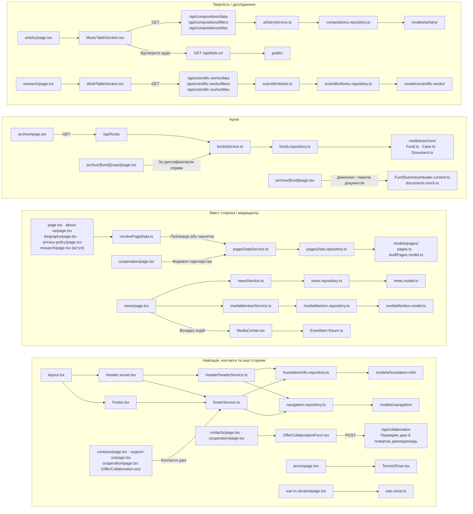

# Архітектура навчального сайту Фундації Лятошинського

Діаграма показує, звідки сторінки в `app/[lang]/` отримують вміст: таблиці творів і наукових праць викликають HTTP API, а серверні компоненти можуть звертатися до сервісів напряму. Контейнер `app/di/container.ts` зв’язує сервіси з `app/services/` та репозиторії з `app/infrastructure/repositories/` через реєстрації в `composedServices.module.ts` і `repositories.module.ts`. Репозиторії читають демобазу MongoDB через моделі в `app/infrastructure/models/`, тоді як опис архівного фонду й таблиця його документів беруться з локальних файлів.

