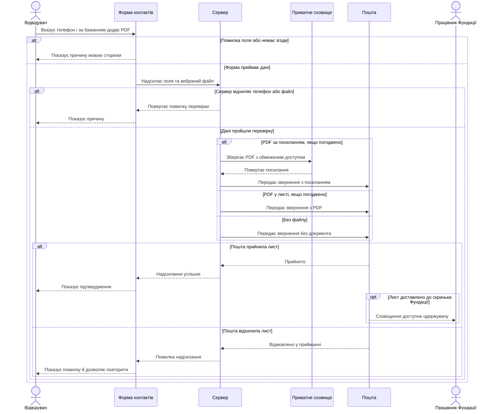

# Контактна форма Фундації Лятошинського

## 1. Короткий опис і вхідний запит

<!-- edited -->
Фундація просить зробити телефон обов’язковим, дозволити відвідувачу додати резюме чи портфоліо та відобразити нове поле у сповіщенні. Спосіб передавання документа працівнику залишається відкритим (Q-03). [Issue № 2](https://github.com/denterra/sdd-workshop-DenisT/issues/2)

> ## Original request
> We want to tighten up the contact form. Phone number should be mandatory.
> We should also let visitors attach a document (CV or portfolio) when they write
> to us. Notifications need to reflect the new field.

## 2. Бізнес-контекст

**Invented, не подтверждено.** Наведені нижче ціль, метрика й обмеження походять із навчальної розмови від імені Фундації. [Коментар Business context](https://github.com/denterra/sdd-workshop-DenisT/issues/2#issuecomment-7009184390)

- **Ціль.** Дати працівнику достатньо матеріалів для першої змістовної відповіді без додаткового листування.
- **Метрика.** За перші 30 днів після запуску щонайменше 80% усіх контактних звернень отримують першу змістовну відповідь без повторного запиту на телефон чи матеріали.
- **Доступ і сповіщення.** Запропоновано обмежити доступ до телефону та PDF працівниками, які опрацьовують звернення. У сповіщенні пропонується показувати наявність файлу та посилання на приватне звернення. Формат доставки й ролі потребують рішення за Q-03 і Q-05.
- **Зберігання.** Запропонований строк видалення телефону й вкладення — 90 днів після закриття звернення. Подію закриття та перелік копій потрібно погодити за Q-06.

У блоці 5 обсяг зміни уточнено до одного необов’язкового PDF розміром до 5 МБ включно. Точна межа в байтах відкрита (Q-01). [Аналіз впливу](https://github.com/denterra/sdd-workshop-DenisT/issues/2#issuecomment-7087264834)

## 3. Користувацькі історії

- Як відвідувач, я хочу вказати номер телефону та побачити помилку, якщо пропущу його або введу некоректно, щоб Фундація отримала мої контактні дані.
- Як відвідувач, я хочу самостійно вирішувати, чи додавати до звернення резюме або портфоліо у PDF, щоб мати змогу звернутися до Фундації й без документа. <!-- edited -->
- Як працівник Фундації, я хочу відкрити доданий документ зі сповіщення, щоб підготувати відповідь без повторного запиту до автора.

## 4. Діаграма послідовності

<!-- edited -->
Сьогодні форма надсилає ім’я, email, телефон (якщо заповнений) і повідомлення на `/api/collaboration`. Сервер перевіряє поля й у разі успіху повертає їх у відповіді. Лист не надсилається, звернення не записується в базу. Якщо сервер відхиляє запит, форма все одно може показати підтвердження: обгортка записує помилку в консоль, а компонент форми відкриває вікно підтвердження після завершення виклику.

Діаграма показує очікуваний потік після зміни. Варіант доставки PDF залежить від Q-03. Поведінку після збою пошти, зокрема долю вже завантаженого файлу, потрібно погодити за Q-04.

## 5. Таблиця правил

«Є зараз» описує поведінку коду. «Має бути» та «Хто вирішив» заповнено для рішень, зафіксованих у вихідній вимозі. Порожня клітинка означає, що такого рішення в таблиці блоку 4 не зафіксовано. UI — форма у браузері, API — обробник на сервері. [Таблиця правил в issue](https://github.com/denterra/sdd-workshop-DenisT/issues/2#issuecomment-7087145787)

| ID | Правило простою мовою | Файл | Джерело істини | Шар | Є зараз | Має бути | Хто вирішив |
| --- | --- | --- | --- | --- | --- | --- | --- |
| RULE-01 | Довжина імені | [ContactForm.tsx:58](https://github.com/denterra/sdd-workshop-DenisT/blob/36a7e8b5fe629b4a1306bf93a037c12c02264608/app/shared/components/forms/contact-form/ContactForm.tsx#L58), [validation.ts:2](https://github.com/denterra/sdd-workshop-DenisT/blob/36a7e8b5fe629b4a1306bf93a037c12c02264608/app/constants/validation.ts#L2) | Схема Zod і константи довжини | UI / API | Обов’язкове поле, від 2 до 50 символів. UI прибирає крайні пробіли, API рахує довжину отриманого рядка. |  |  |
| RULE-02 | Формат електронної адреси | [ContactForm.tsx:64](https://github.com/denterra/sdd-workshop-DenisT/blob/36a7e8b5fe629b4a1306bf93a037c12c02264608/app/shared/components/forms/contact-form/ContactForm.tsx#L64), [validation.ts:11](https://github.com/denterra/sdd-workshop-DenisT/blob/36a7e8b5fe629b4a1306bf93a037c12c02264608/app/constants/validation.ts#L11) | Схема Zod і регулярний вираз `EMAIL_PATTERN` | UI / API | Адреса обов’язкова. Браузер застосовує перевірку Zod, сервер — власний вираз. Наприклад, сервер відхиляє адресу з плюсом перед @. |  |  |
| RULE-03 | Довжина повідомлення | [ContactForm.tsx:66](https://github.com/denterra/sdd-workshop-DenisT/blob/36a7e8b5fe629b4a1306bf93a037c12c02264608/app/shared/components/forms/contact-form/ContactForm.tsx#L66), [validateContactData.ts:34](https://github.com/denterra/sdd-workshop-DenisT/blob/36a7e8b5fe629b4a1306bf93a037c12c02264608/app/lib/utils/validateContactData.ts#L34), [validation.ts:6](https://github.com/denterra/sdd-workshop-DenisT/blob/36a7e8b5fe629b4a1306bf93a037c12c02264608/app/constants/validation.ts#L6) | Схема Zod і константи довжини | UI / API | Від 10 до 1000 символів. UI прибирає крайні пробіли, API рахує їх. |  |  |
| RULE-04 | Обов’язковість телефону | [ContactForm.tsx:65](https://github.com/denterra/sdd-workshop-DenisT/blob/36a7e8b5fe629b4a1306bf93a037c12c02264608/app/shared/components/forms/contact-form/ContactForm.tsx#L65), [validateContactData.ts:23](https://github.com/denterra/sdd-workshop-DenisT/blob/36a7e8b5fe629b4a1306bf93a037c12c02264608/app/lib/utils/validateContactData.ts#L23) | Схема `.optional()` та умова `if (phoneNumber)` | UI / API | Форма й обидва API приймають звернення з порожнім або відсутнім номером. | Для надсилання контактної форми потрібен номер телефону. | Замовник за умовою вправи, [issue #2](https://github.com/denterra/sdd-workshop-DenisT/issues/2) |
| RULE-05 | Формат заповненого телефону | [useHandlePhoneInput.ts:73](https://github.com/denterra/sdd-workshop-DenisT/blob/36a7e8b5fe629b4a1306bf93a037c12c02264608/app/shared/hooks/use-handle-phone-input/useHandlePhoneInput.ts#L73), [normalizePhoneNumberFromMask.ts:4](https://github.com/denterra/sdd-workshop-DenisT/blob/36a7e8b5fe629b4a1306bf93a037c12c02264608/app/lib/utils/normalizePhoneNumberFromMask.ts#L4), [validation.ts:4](https://github.com/denterra/sdd-workshop-DenisT/blob/36a7e8b5fe629b4a1306bf93a037c12c02264608/app/constants/validation.ts#L4) | Префікс `38`, довідник кодів країн, регулярний вираз та межі довжини | UI / API | Початковий `0` форма трактує як український номер. Перед надсиланням прибирає маску. API приймає `+` і 10–15 цифр. |  |  |
| RULE-06 | Згода на обробку даних | [ContactForm.tsx:72](https://github.com/denterra/sdd-workshop-DenisT/blob/36a7e8b5fe629b4a1306bf93a037c12c02264608/app/shared/components/forms/contact-form/ContactForm.tsx#L72), [ContactForm.tsx:88](https://github.com/denterra/sdd-workshop-DenisT/blob/36a7e8b5fe629b4a1306bf93a037c12c02264608/app/shared/components/forms/contact-form/ContactForm.tsx#L88), [OfferCollaborationForm.tsx:35](https://github.com/denterra/sdd-workshop-DenisT/blob/36a7e8b5fe629b4a1306bf93a037c12c02264608/app/shared/components/forms/offer-collaboration-form/OfferCollaborationForm.tsx#L35) | Початкове `policy: false`, перевірка `refine`, перелік полів JSON | UI / API | Прапорець спочатку знятий. Для надсилання через UI його треба встановити. У запиті та серверній перевірці поле згоди відсутнє. |  |  |
| RULE-07 | Мова підказок і помилок | [routing.ts:4](https://github.com/denterra/sdd-workshop-DenisT/blob/36a7e8b5fe629b4a1306bf93a037c12c02264608/i18n/routing.ts#L4), [ContactForm.tsx:37](https://github.com/denterra/sdd-workshop-DenisT/blob/36a7e8b5fe629b4a1306bf93a037c12c02264608/app/shared/components/forms/contact-form/ContactForm.tsx#L37), [errors.ts:3](https://github.com/denterra/sdd-workshop-DenisT/blob/36a7e8b5fe629b4a1306bf93a037c12c02264608/app/constants/errors.ts#L3) | Налаштування локалі, словники, рядки помилок API | UI / API | Підписи й підказки доступні українською та англійською. Типова мова — українська. API повертає англомовні помилки. |  |  |
| RULE-08 | Момент появи помилки або підказки | [ContactForm.tsx:88](https://github.com/denterra/sdd-workshop-DenisT/blob/36a7e8b5fe629b4a1306bf93a037c12c02264608/app/shared/components/forms/contact-form/ContactForm.tsx#L88), [ContactForm.tsx:99](https://github.com/denterra/sdd-workshop-DenisT/blob/36a7e8b5fe629b4a1306bf93a037c12c02264608/app/shared/components/forms/contact-form/ContactForm.tsx#L99), [useAutoHideMessage.ts:3](https://github.com/denterra/sdd-workshop-DenisT/blob/36a7e8b5fe629b4a1306bf93a037c12c02264608/app/shared/hooks/use-auto-hide-message/useAutoHideMessage.ts#L3) | Режим `onChange`, пороги 50 і 1000, таймер 3000 мс | UI | Поля перевіряються під час введення. При досягненні ліміту імені або повідомлення підказка зникає через три секунди. |  |  |
| RULE-09 | Результат після помилки надсилання | [OfferCollaborationForm.tsx:45](https://github.com/denterra/sdd-workshop-DenisT/blob/36a7e8b5fe629b4a1306bf93a037c12c02264608/app/shared/components/forms/offer-collaboration-form/OfferCollaborationForm.tsx#L45), [ContactForm.tsx:107](https://github.com/denterra/sdd-workshop-DenisT/blob/36a7e8b5fe629b4a1306bf93a037c12c02264608/app/shared/components/forms/contact-form/ContactForm.tsx#L107) | Умови `response.ok`, `catch` і відкриття підтвердження | UI / API | Помилка запиту потрапляє в консоль. Форма може показати підтвердження навіть після відмови API. Закриття підтвердження очищає форму. |  |  |
| RULE-10 | Додавання документа | [ContactForm.tsx:25](https://github.com/denterra/sdd-workshop-DenisT/blob/36a7e8b5fe629b4a1306bf93a037c12c02264608/app/shared/components/forms/contact-form/ContactForm.tsx#L25), [OfferCollaborationForm.tsx:35](https://github.com/denterra/sdd-workshop-DenisT/blob/36a7e8b5fe629b4a1306bf93a037c12c02264608/app/shared/components/forms/offer-collaboration-form/OfferCollaborationForm.tsx#L35), [route.ts:7](https://github.com/denterra/sdd-workshop-DenisT/blob/36a7e8b5fe629b4a1306bf93a037c12c02264608/app/api/collaboration/route.ts#L7) | Склад полів форми, JSON-запиту та обробника | UI / API | Вибір, передавання й збереження файлу відсутні. | Відвідувач може додати CV або портфоліо. | Замовник за умовою вправи, [issue #2](https://github.com/denterra/sdd-workshop-DenisT/issues/2) |
| RULE-11 | Дані у сповіщенні | [emails.ts:19](https://github.com/denterra/sdd-workshop-DenisT/blob/36a7e8b5fe629b4a1306bf93a037c12c02264608/app/services/email/emails/emails.ts#L19), [emails.ts:88](https://github.com/denterra/sdd-workshop-DenisT/blob/36a7e8b5fe629b4a1306bf93a037c12c02264608/app/services/email/emails/emails.ts#L88) | Умовна вставка номера в HTML і текст листа | Зовнішній (пошта) | Шаблони додають телефон, коли його передано. Інформація про вкладення відсутня. | Сповіщення має відображати нове поле. Точний вміст потребує уточнення. | Замовник за умовою вправи, [issue #2](https://github.com/denterra/sdd-workshop-DenisT/issues/2) |
| RULE-12 | Фактичне надсилання листа | [route.ts:17](https://github.com/denterra/sdd-workshop-DenisT/blob/36a7e8b5fe629b4a1306bf93a037c12c02264608/app/api/collaboration/route.ts#L17), [route.ts:16](https://github.com/denterra/sdd-workshop-DenisT/blob/36a7e8b5fe629b4a1306bf93a037c12c02264608/app/api/contact/route.ts#L16), [emailService.ts:10](https://github.com/denterra/sdd-workshop-DenisT/blob/36a7e8b5fe629b4a1306bf93a037c12c02264608/app/services/email/emailService.ts#L10) | Повернення JSON в API та літерал `success: true` у поштовому сервісі | API / зовнішній | Обидва обробники повертають відповідь без виклику поштового сервісу. Сам сервіс працює як заглушка. |  |  |
| RULE-13 | Збереження звернення | [route.ts:17](https://github.com/denterra/sdd-workshop-DenisT/blob/36a7e8b5fe629b4a1306bf93a037c12c02264608/app/api/collaboration/route.ts#L17), [route.ts:16](https://github.com/denterra/sdd-workshop-DenisT/blob/36a7e8b5fe629b4a1306bf93a037c12c02264608/app/api/contact/route.ts#L16) | Тіло успішної відповіді | API | Обробники повертають дані заявнику. Запису звернення в базу в цьому потоці немає. |  |  |
| RULE-14 | Доступність форми під час надсилання | [ContactForm.tsx:36](https://github.com/denterra/sdd-workshop-DenisT/blob/36a7e8b5fe629b4a1306bf93a037c12c02264608/app/shared/components/forms/contact-form/ContactForm.tsx#L36), [OfferCollaborationForm.tsx:27](https://github.com/denterra/sdd-workshop-DenisT/blob/36a7e8b5fe629b4a1306bf93a037c12c02264608/app/shared/components/forms/offer-collaboration-form/OfferCollaborationForm.tsx#L27), [OfferCollaborationForm.tsx:59](https://github.com/denterra/sdd-workshop-DenisT/blob/36a7e8b5fe629b4a1306bf93a037c12c02264608/app/shared/components/forms/offer-collaboration-form/OfferCollaborationForm.tsx#L59), [OfferCollaborationForm.tsx:71](https://github.com/denterra/sdd-workshop-DenisT/blob/36a7e8b5fe629b4a1306bf93a037c12c02264608/app/shared/components/forms/offer-collaboration-form/OfferCollaborationForm.tsx#L71) | Початкове `disabled = false`, стан `isSubmitting` | UI | Поля, прапорець і кнопка доступні до надсилання. Поки триває запит, вони заблоковані. Після завершення запиту блокування знімається. |  |  |
| RULE-15 | Неповний номер і очищення поля | [useHandlePhoneInput.ts:152](https://github.com/denterra/sdd-workshop-DenisT/blob/36a7e8b5fe629b4a1306bf93a037c12c02264608/app/shared/hooks/use-handle-phone-input/useHandlePhoneInput.ts#L152), [useHandlePhoneInput.ts:181](https://github.com/denterra/sdd-workshop-DenisT/blob/36a7e8b5fe629b4a1306bf93a037c12c02264608/app/shared/hooks/use-handle-phone-input/useHandlePhoneInput.ts#L181), [ContactForm.tsx:107](https://github.com/denterra/sdd-workshop-DenisT/blob/36a7e8b5fe629b4a1306bf93a037c12c02264608/app/shared/components/forms/contact-form/ContactForm.tsx#L107) | Перевірка коду країни й довжини, прапорець `hasError` | UI | Нерозпізнаний код або занадто короткий номер для відомої країни блокує надсилання. Повне очищення поля скидає помилку. |  |  |
| RULE-16 | Відповідь на помилки запиту | [validateContactData.ts:13](https://github.com/denterra/sdd-workshop-DenisT/blob/36a7e8b5fe629b4a1306bf93a037c12c02264608/app/lib/utils/validateContactData.ts#L13), [apiResponse.ts:12](https://github.com/denterra/sdd-workshop-DenisT/blob/36a7e8b5fe629b4a1306bf93a037c12c02264608/app/lib/utils/apiResponse.ts#L12), [route.ts:25](https://github.com/denterra/sdd-workshop-DenisT/blob/36a7e8b5fe629b4a1306bf93a037c12c02264608/app/api/collaboration/route.ts#L25), [route.ts:5](https://github.com/denterra/sdd-workshop-DenisT/blob/36a7e8b5fe629b4a1306bf93a037c12c02264608/app/api/contact/route.ts#L5) | Масив помилок, HTTP 400, гілка `catch` | API | При помилках полів обидва API повертають 400 і перелік помилок. При помилці читання JSON обробник collaboration повертає 500 із загальним повідомленням. У contact цей виняток передається фреймворку. |  |  |
| RULE-17 | Додаткові поля у відповіді | [validateRequestData.ts:7](https://github.com/denterra/sdd-workshop-DenisT/blob/36a7e8b5fe629b4a1306bf93a037c12c02264608/app/lib/utils/validateRequestData.ts#L7), [route.ts:15](https://github.com/denterra/sdd-workshop-DenisT/blob/36a7e8b5fe629b4a1306bf93a037c12c02264608/app/api/collaboration/route.ts#L15), [route.ts:14](https://github.com/denterra/sdd-workshop-DenisT/blob/36a7e8b5fe629b4a1306bf93a037c12c02264608/app/api/contact/route.ts#L14) | Повернення початкового об’єкта `value: data` | shared / API | Для коректного звернення додаткові поля JSON повертаються разом із перевіреними. Назва файлу в такій відповіді не свідчить про його завантаження. |  |  |
| RULE-18 | Тип форми в поштовому шаблоні | [emails.ts:85](https://github.com/denterra/sdd-workshop-DenisT/blob/36a7e8b5fe629b4a1306bf93a037c12c02264608/app/services/email/emails/emails.ts#L85) | Типове значення `formType = 'Contact'` | Зовнішній (пошта) | Якщо тип форми пропущено, генератор використовує Contact у заголовку й тексті шаблону. |  |  |

## 6. Критерії приймання

Опубліковані англомовні сценарії збережено з їхніми ідентифікаторами. **Given** задає передумову, **When** — дію, **Then** — результат. **L** — максимальний розмір одного PDF у байтах (Q-01). MIME — заявлений тип файлу, наприклад `application/pdf`. [Критерії в issue](https://github.com/denterra/sdd-workshop-DenisT/issues/2#issuecomment-7087437457)

### Контактна форма

Each run uses otherwise valid input and checked consent unless the scenario varies that input. Error names refer to the EN/UK copy table. Run validation examples separately. AC-05, AC-06 and AC-19 can be executed at the exact boundary once L is agreed.

| ID | Given … When … Then … | Related RULE-ID |
|---|---|---|
| AC-01 | **Given** the phone field is empty (untouched or cleared), **When** the visitor submits the contact form, **Then** the required-phone error appears beside the phone field. | RULE-04, RULE-07, RULE-15 |
| AC-02 | **Given** a contact request has a missing, empty or whitespace-only phone field, **When** the API receives it, **Then** the API rejects it with a phone-field validation error. | RULE-04, RULE-16 |
| AC-03 | **Given** a valid PDF is selected and the contact phone field contains the incomplete number `+380 (63) 116-46`, **When** the visitor submits, **Then** the phone-format error appears beside the field. | RULE-05, RULE-15 |
| AC-04 | **Given** the visitor entered `+380 (63) 116-4627` and selected no file, **When** the Foundation opens the resulting contact notification, **Then** the notification contains the submitted name, reply email, normalized phone `+380631164627` and message. | RULE-04, RULE-05, RULE-11, RULE-12 |
| AC-05 | **Given** the visitor selects one genuine PDF declared as `application/pdf` (test sizes: L − 1 and L bytes), **When** they submit the contact form, **Then** the contact submission is accepted. | RULE-10, RULE-16 |
| AC-06 | **Given** the selected PDF is L + 1 bytes, **When** the visitor attempts submission, **Then** the file-size error appears beside the file field. | RULE-07, RULE-10 |
| AC-07 | **Given** the selected file has MIME type `image/png`, **When** the visitor attempts submission, **Then** the PDF-only error appears beside the file field. | RULE-07, RULE-10 |
| AC-08 | **Given** the visitor has selected a valid PDF and left the privacy checkbox unchecked, **When** they attempt submission, **Then** the consent error appears beside the checkbox. | RULE-06, RULE-07, RULE-10 |
| AC-09 | **Given** the visitor submits a contact request with a PDF, **When** the request is pending, **Then** the submit button is disabled. | RULE-10, RULE-14 |
| AC-10 | **Given** the Foundation’s mail service rejects the send attempt, **When** the form receives the failure response, **Then** the form displays the send-failure message for the active language. | RULE-07, RULE-09, RULE-12, RULE-16 |
| AC-11 | **Given** the Contacts page is open in EN or UK, **When** a condition in the copy table occurs, **Then** the visible error matches the entry for that condition and language. | RULE-07, RULE-08, RULE-16 |
| AC-16 | **Given** the contact request has a valid phone and no file, **When** the visitor submits it, **Then** the form confirms successful submission. | RULE-04, RULE-09, RULE-10 |
| AC-17 | **Given** a contact request has a phone and no file, **When** the Foundation opens its notification, **Then** the message offers no document to download. | RULE-10, RULE-11 |
| AC-18 | **Given** a contact request includes an accepted PDF, **When** the recipient opens the document from the notification, **Then** the retrieved file is byte-for-byte identical to the submitted PDF. | RULE-10, RULE-11, RULE-12 |
| AC-19 | **Given** a direct contact request carries a PDF of L + 1 bytes, **When** the API receives it, **Then** the API rejects it with a file-size validation error. | RULE-10, RULE-16 |
| AC-20 | **Given** a direct contact request declares an attachment as `image/png`, **When** the API receives it, **Then** the API rejects it with a file-type validation error. | RULE-10, RULE-16 |
| AC-21 | **Given** a plain-text file is named `cv.pdf` and declared as `application/pdf`, **When** the contact API receives it, **Then** the API rejects it with a file-type validation error. | RULE-10, RULE-16 |
| AC-22 | **Given** one contact request is already pending, **When** the visitor clicks submit again, **Then** the submission request count stays at one. | RULE-10, RULE-14 |
| AC-23 | **Given** a contact submission with a valid phone fails, **When** the visitor returns to the form, **Then** the submit button is available for retry. | RULE-09, RULE-14 |
| AC-24 | **Given** a contact submission with a valid phone fails, **When** the visitor returns to the form, **Then** the name, email, phone and message fields still contain their submitted values. | RULE-04, RULE-09 |
| AC-25 | **Given** the mail service has rejected the contact request, **When** the form receives the failure response, **Then** the success confirmation remains hidden. | RULE-09, RULE-12 |
| AC-26 | **Given** a contact submission has a missing phone or invalid attachment, **When** the API rejects it, **Then** the test mailbox receives zero notifications for that submission. | RULE-04, RULE-10, RULE-12, RULE-16 |
| AC-27 | **Given** the visitor left the phone field empty, selected an oversized PDF, selected a PNG or left consent unchecked (one case per run), **When** they try to submit the contact form, **Then** the browser makes zero submission requests. | RULE-04, RULE-06, RULE-10 |
| AC-28 | **Given** the visitor submits one valid contact request with an optional PDF, **When** submission completes successfully, **Then** the test mailbox contains exactly one notification for that request. | RULE-10, RULE-12, RULE-14 |

### Доступ і зберігання · очікують рішення Фундації

**Invented, не подтверждено.** Confirm the delivery option, access roles, event that marks closure and storage locations before using these criteria for sign-off. Use distinct submission and closure dates in retention tests.

| ID | Given … When … Then … | Related RULE-ID |
|---|---|---|
| AC-13 | **Given** secure-link delivery is agreed and a contact request is accepted, **When** the recipient opens its notification, **Then** the message contains a link to that private submission. | RULE-11, RULE-13 |
| AC-14 | **Given** a private submission contains a phone number, **When** a user opens it, **Then** the visibility of the phone number matches the access matrix below. | RULE-11, RULE-13 |
| AC-15 | **Given** the phone number is present at closure, **When** 90 days have elapsed since the recorded closure time, **Then** the number is absent from the agreed storage locations. | RULE-13 |
| AC-29 | **Given** secure-link delivery is agreed, **When** the recipient opens a notification for a submission with or without a PDF, **Then** the attachment status in the message matches whether the visitor supplied a PDF. | RULE-10, RULE-11 |
| AC-30 | **Given** a PDF is stored for a private submission, **When** a user follows its file link, **Then** the download outcome matches the access matrix below. | RULE-10, RULE-11, RULE-13 |
| AC-31 | **Given** a PDF is present at closure, **When** 90 days have elapsed since the recorded closure time, **Then** the PDF is absent from the agreed storage locations. | RULE-10, RULE-13 |
| AC-32 | **Given** a PDF was accessible through a private link at closure, **When** an authorized handler follows that link 90 days after closure, **Then** the link no longer retrieves the PDF. | RULE-10, RULE-13 |
| AC-33 | **Given** secure-link delivery is agreed and a submission has no PDF, **When** an authorized handler opens the private submission, **Then** the submission offers no file to download. | RULE-10, RULE-13 |

| Test identity | Phone visible (AC-14) | PDF downloadable (AC-30) |
|---|---|---|
| Handler authorized for this submission | Yes | Yes |
| Staff member without handling permission | No | No |
| Signed-out visitor | No | No |

### Тексти помилок для AC-11

| Condition | EN | UK | Copy status |
|---|---|---|---|
| Empty phone | Enter your phone number. | Вкажіть номер телефону. | Proposed |
| Invalid phone format | Check the phone number format | Перевірте формат номера телефону | Existing |
| File too large | Choose a PDF no larger than 5 MB. | Виберіть PDF розміром до 5 МБ включно. | Proposed |
| Wrong file type | Choose a PDF file. | Виберіть файл у форматі PDF. | Proposed |
| Privacy consent unchecked | You must agree to continue | Щоб продовжити, потрібно дати згоду | Existing |
| Send failed | Your request could not be sent. Please try again. | Не вдалося надіслати звернення. Спробуйте ще раз. | Proposed |

## 7. Таблиця ключових файлів

| Шлях у репозиторії | Роль у контактному зверненні |
|---|---|
| [app/\[lang\]/contacts/ContactsInfo/ContactsInfo.tsx](../app/%5Blang%5D/contacts/ContactsInfo/ContactsInfo.tsx) | Відкриває відвідувачу форму на сторінці «Контакти». |
| [app/shared/components/forms/contact-form/ContactForm.tsx](../app/shared/components/forms/contact-form/ContactForm.tsx) | Поля, перевірки у браузері, згода та підтвердження. |
| [app/shared/components/forms/offer-collaboration-form/OfferCollaborationForm.tsx](../app/shared/components/forms/offer-collaboration-form/OfferCollaborationForm.tsx) | Надсилає поля до сервера та обробляє його відповідь. |
| [app/shared/components/blocks/partnership-formats/PartnershipFormats.tsx](../app/shared/components/blocks/partnership-formats/PartnershipFormats.tsx) | Партнерська сторінка використовує ту саму обгортку форми (Q-09). |
| [app/shared/components/get-notes-modal/GetNotesModal.tsx](../app/shared/components/get-notes-modal/GetNotesModal.tsx) | Форма отримання нот використовує той самий компонент і відкриває локальне підтвердження. |
| [app/api/collaboration/route.ts](../app/api/collaboration/route.ts) | Чинна точка прийому звернення зі сторінки «Контакти». |
| [app/api/contact/route.ts](../app/api/contact/route.ts) | Окремий обробник контактних звернень. Його підключення — один із варіантів зміни. |
| [app/constants/validation.ts](../app/constants/validation.ts) | Межі довжини і правила формату полів. |
| [app/lib/utils/validateContactData.ts](../app/lib/utils/validateContactData.ts) | Перевіряє поля на сервері. Телефон перевіряється лише за наявності значення. |
| [app/shared/hooks/use-handle-phone-input/useHandlePhoneInput.ts](../app/shared/hooks/use-handle-phone-input/useHandlePhoneInput.ts) | Обробляє введення, очищення та неповний номер. |
| [app/services/email/emailService.ts](../app/services/email/emailService.ts) | Демонстраційний поштовий сервіс повертає ознаку успіху. |
| [app/services/email/emails/emails.ts](../app/services/email/emails/emails.ts) | Готує текстову та HTML-версії повідомлення. |
| [app/services/upload/upload.ts](../app/services/upload/upload.ts) | Демонстраційний сервіс. Методи запису й видалення порожні. Потенційна точка підключення приватного сховища. |
| [app/validators/blob.schema.ts](../app/validators/blob.schema.ts) | Містить PDF серед кількох типів файлів. Окремого обмеження 5 МБ для звернень тут немає. |
| [app/api/blob-url/route.ts](../app/api/blob-url/route.ts) | Видає демонстраційні файли з публічного каталогу. |
| [i18n/messages/uk.json](../i18n/messages/uk.json) | Українські підписи та помилки контактної форми. |
| [i18n/messages/en.json](../i18n/messages/en.json) | Англійські підписи та помилки контактної форми. |
| [app/lib/utils/validateContactData.test.ts](../app/lib/utils/validateContactData.test.ts) | Фіксує поточне приймання сервером звернення без телефону. |
| [app/shared/components/forms/contact-form/ContactForm.test.tsx](../app/shared/components/forms/contact-form/ContactForm.test.tsx) | Перевіряє форму, зокрема приклад перетворення номера з маскою на номер для надсилання. |

### Аналіз впливу

| Зачеплена область | Тип зміни (нова/змінена/видалена) | Ризик (високий/середній/низький) | Рекомендована дія | Ідея регресійного тесту | Пов'язані RULE-ID |
|---|---|---|---|---|---|
| Сторінка «Контакти» та спільна форма · `ContactsInfo.tsx`, `ContactForm.tsx`, `OfferCollaborationForm.tsx` | змінена | високий | Увімкнути обов’язковий телефон і вибір одного необов’язкового PDF лише для контактного звернення. Форму також використовують `PartnershipFormats.tsx` і `GetNotesModal.tsx`. | На «Контактах» звернення з телефоном проходить без PDF. Партнерська форма й отримання нот працюють за попередніми правилами. | RULE-04, RULE-10, RULE-15 |
| Телефон на клієнті й сервері · `ContactForm.tsx`, `useHandlePhoneInput.ts`, `validateContactData.ts`, `app/constants/validation.ts` | змінена | високий | У контактному сценарії відхиляти відсутній і порожній номер, зокрема після очищення поля. Зберегти чинну маску й перевірку формату. | Очистити валідний телефон і спробувати надіслати форму. Окремо перевірити прямі API-запити без поля, з порожнім, неповним і валідним номером. | RULE-04, RULE-05, RULE-15, RULE-16 |
| Перевірка PDF на клієнті й сервері · `ContactForm.tsx`, `app/validators/blob.schema.ts`, нова перевірка вкладення | нова | високий | Винести межу в байтах у спільну константу. UI перевіряє тип і розмір. API також перевіряє вміст файлу. Наявна схема містить PDF серед кількох MIME-типів і не встановлює ліміт 5 МБ. | Без файлу та з PDF рівно на межі — успіх. На один байт понад межу або з іншим вмістом під назвою `.pdf` — відмова API до надсилання листа. | RULE-10, RULE-16 |
| Маршрут і формат запиту · `OfferCollaborationForm.tsx`, `app/api/contact/route.ts`, `app/api/collaboration/route.ts` | змінена | високий | Рекомендований варіант — спрямувати «Контакти» на `/api/contact` і приймати поля та файл через `multipart/form-data`. Зараз форма надсилає JSON на `/api/collaboration`. У відповіді повертати результат операції без вмісту CV. | Надіслати звернення з кожної сторінки. Контактне передає файл на обраний маршрут, партнерське й далі приймає попередній JSON. | RULE-10, RULE-16, RULE-17 |
| Результат надсилання · `OfferCollaborationForm.tsx`, `ContactForm.tsx` | змінена | високий | Передавати помилку API з обгортки до форми. Показувати підтвердження після успішної відповіді. При збої зберігати введені дані та дозволяти повторну спробу. | Імітувати відмову пошти. Користувач бачить помилку, дані залишаються у формі, повторне натискання під час запиту заблоковане. | RULE-09, RULE-12, RULE-14, RULE-16 |
| Пошта · `app/services/email/emailService.ts`, `app/services/email/emails/emails.ts` | змінена | високий | Підключити реальне надсилання з контактного маршруту. Для вкладення передати байти PDF поштовому провайдеру. Для посилання додати його в HTML і текстову версію листа. | У тестовій скриньці відкрити надісланий PDF або скачати його за посиланням і звірити вміст. Окремо перевірити лист із телефоном без файлу. | RULE-10, RULE-11, RULE-12, RULE-18 |
| Приватне сховище та видача за посиланням · `app/services/upload/upload.ts`, `app/api/blob-url/route.ts` | нова | високий | Потрібно для варіанта з посиланням. Сервіс зареєстрований у контейнері залежностей, але його методи викликають лише тести. Запис і видалення — демозаглушки. Для CV можна повторно використати цей сервіс, реалізувавши приватне збереження та контрольований доступ. Чинний демомаршрут читає з `public`. | Одержувач відкриває правильний PDF. Після завершення погодженого строку доступу посилання більше не видає документ. | RULE-10, RULE-11, RULE-13 |
| Локалізація й помилки · `i18n/messages/uk.json`, `i18n/messages/en.json`, `app/constants/errors.ts` | змінена | низький | Додати підписи й повідомлення для обов’язкового телефону, необов’язкового PDF, перевищення розміру, неприйнятного формату та збою надсилання. | В обох локалях перевірити підпис поля та викликати кожну помилку. Для порожнього й некоректного телефону показуються різні підказки. | RULE-04, RULE-07, RULE-08, RULE-10, RULE-16 |
| Моделі БД і репозиторії звернень | нова | середній | Умовно, якщо Фонд погодить облік заявок або метаданих файлів. Поточний маршрут не записує звернення в MongoDB. PDF безпосередньо в листі можна надіслати без нової моделі. | Для поштового сценарію перевірити доставку без запису заявки в БД. Якщо вводиться облік — перевірити збереження звернень із файлом і без нього. | RULE-10, RULE-13 |
| Конфігурація середовищ · `app/config/index.ts`, `.env.example`, ліміти розгортання | змінена | високий | Налаштувати відправника, одержувача та поштовий транспорт. Для посилань додати конфігурацію сховища. Звірити межі всього HTTP-запиту й розміру закодованого листа з лімітом самого PDF. | Провести файл граничного розміру через тестове середовище до скриньки Фонду. Імітувати відсутню конфігурацію та перевірити відображення помилки. | RULE-09, RULE-10, RULE-11, RULE-12 |
| Автоматизовані тести · тести форм, `validateContactData.test.ts`, тести обох API, `emailServise.test.ts`, `emails.test.ts`, умовно `upload.test.ts` | змінена | середній | Оновити очікування для контактного сценарію та додати наскрізну перевірку доставки. Зберегти покриття наявних перевірок імені, email, повідомлення й згоди. | Пройти шлях від сторінки до одержувача з PDF і без нього. Окремо перевірити межі файлу, збій доставки й обидві форми, що повторно використовують компонент. | RULE-01, RULE-02, RULE-03, RULE-04, RULE-06, RULE-09, RULE-10, RULE-11, RULE-12 |

## 8. Відкриті питання

Ролі та дата відповіді 26 листопада 2026 року запропоновані для планування. Фундація їх ще не погодила. [Питання в issue](https://github.com/denterra/sdd-workshop-DenisT/issues/2#issuecomment-7087438919)

| ID | Question | Why it blocks development | Decision owner (role) | Answer by (proposed) | Related AC / RULE |
|---|---|---|---|---|---|
| Q-01 | Does “up to 5 MB” include a PDF of exactly 5,000,000 bytes or exactly 5,242,880 bytes? | The form, API and boundary tests need the same last accepted byte. | Product Owner | 2026-11-26 | AC-05, AC-06, AC-19 / RULE-10 |
| Q-02 | Do you approve the proposed English and Ukrainian error texts in AC-11? Should staff notifications follow the visitor’s language or use a fixed language for the Foundation? | The answers determine the expected text for each locale in the form and in the recipient’s mailbox. | Foundation content lead | 2026-11-26 | AC-04, AC-10, AC-11 / RULE-07, RULE-11 |
| Q-03 | Should staff receive the PDF in the email itself or through a private link? If the file is kept outside email, is private server disk or private object storage (blob) approved? | Email-only delivery and link delivery require different storage, access and deletion arrangements. | Foundation service owner, with IT lead | 2026-11-26 | AC-13, AC-17, AC-18 / RULE-10, RULE-11, RULE-13 |
| Q-04 | If the PDF is saved but email delivery fails, should the Foundation keep the request and retry delivery, or discard it and ask the visitor to resubmit? What should the visitor see? | This sets the success condition and determines how to avoid duplicate requests or files left behind after a retry. | Foundation contact-operations lead | 2026-11-26 | AC-10, AC-23, AC-24, AC-25, AC-28 / RULE-09, RULE-12, RULE-13 |
| Q-05 | Which mailbox receives notifications, and who may see the phone number or open the PDF: everyone handling enquiries or only the staff assigned to that submission? | The recipient list and access tests depend on the authorized audience. This also determines whether putting the phone or CV directly in a shared mailbox is acceptable. | Foundation data owner | 2026-11-26 | AC-04, AC-14, AC-18, AC-30 / RULE-11, RULE-13 |
| Q-06 | What retention period applies to the phone and PDF, what event starts it, and which copies must be deleted, including email attachments? If it starts at closure, who marks a request closed and where? | The proposed 90 days after closure is unconfirmed. Without the start event and covered copies, the deletion date cannot be calculated or tested. | Foundation privacy lead | 2026-11-26 | AC-15, AC-31, AC-32 / RULE-10, RULE-13 |
| Q-07 | Does the existing privacy notice cover CV processing? Must the server reject a request without consent, and does the Foundation need a record of that consent? | Today only the browser checks the box. The answer determines the wording, the API contract and whether consent evidence must be stored. | Foundation privacy lead | 2026-11-26 | AC-08, AC-27 / RULE-06, RULE-13, RULE-16 |
| Q-08 | Which email addresses should the contact form accept? For example, should a visitor be able to use `name+cv@example.org`? | The browser and server apply different rules. The answer determines whether a visitor with otherwise valid contact details can complete submission. | Product Owner | 2026-11-26 | AC-04, AC-16 / RULE-02, RULE-16 |
| Q-09 | Is a phone number required only on Contacts? Should partnership enquiries and requests for notes still work without a phone or PDF? | All three flows use the shared form. The answer sets the scope of the new validation and the regression tests. | Product Owner | 2026-11-26 | AC-01, AC-02, AC-16 / RULE-04, RULE-10, RULE-15 |
