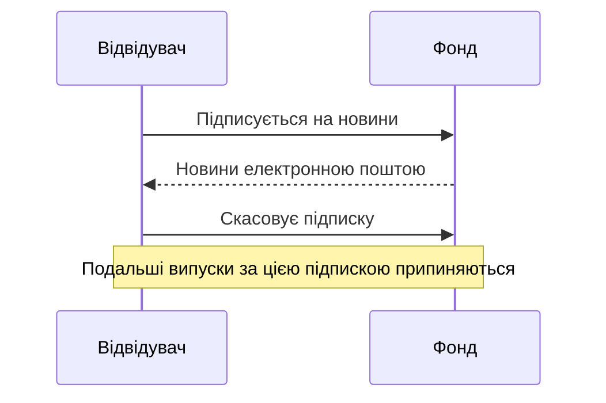

# Підписка на новини Фонду — одна вимога у трьох форматах

> Хочемо, щоб відвідувачі могли підписатися на новини Фонду електронною поштою. Підписку треба легко скасувати.

Джерело для всіх трьох чернеток — ця цитата з блоку 4. ★ позначає перше місце у відповідному шаблоні, де довелося зупинитися й поставити конкретне питання. `TBD` — відповіді у вимозі немає. `Invented` — запропонований для перевірки сценарій або припущення. Ідентифікатори слугують посиланнями всередині вправи.

## A. Користувацькі історії

**ID запиту:** REQ-NEWS-01

**Джерело:** вправа блоку 4

**Дата чернетки:** 26.11.2026

### Короткий опис

Відвідувач хоче отримувати новини Фонду електронною поштою. Коли він більше не хоче їх отримувати, підписку має бути легко скасувати.

### Користувацькі історії

#### Історія 1

**US-01.** Як відвідувач, я хочу підписатися на новини Фонду, щоб отримувати їх на свою електронну адресу.

**Критерій приймання (чернетка)**

- [ ] **AC-01.** Дано відвідувача, який завершив підписку. Коли Фонд розсилає новий випуск, відвідувач отримує його електронною поштою.

#### Історія 2

**US-02.** Як підписник, я хочу легко скасувати підписку, щоб припинити отримувати новини.

**Критерій приймання (чернетка)**

- [ ] **AC-02.** Дано чинну підписку. Коли підписник її скасовує, а Фонд згодом готує й розсилає новий випуск, цей випуск не надходить за скасованою підпискою.
- ★ Як перевірити, що сам підписник легко впорався зі скасуванням? Ознака зручності — TBD. Навіть успішний AC-02 нічого не скаже про зусилля людини.

### Припущення

`Invented` — підписник очікує, що зможе скасувати підписку самостійно. Це потрібно уточнити з відвідувачами.

### Поза межами (неформально)

Погоджені виключення — TBD.

### Відкриті питання

| № | Питання | Власник | Потрібно до |
| --- | --- | --- | --- |
| A-Q1 | За якою ознакою відвідувач оцінить скасування як легке? | TBD | Погодження критерію зручності для US-02 |
| A-Q2 | У який момент відвідувач уже вважається підписаним? | TBD | Перевірки початкових умов AC-01 |

### Залежності

Потрібна можливість розіслати новину електронною поштою. Хто відповідає за розсилку і як вона працює — TBD.

### Нотатки / ризики

Відсутність листа після скасування сама по собі мало про що свідчить. Для перевірки AC-02 потрібно також встановити, що випуск справді розіслали.

**Рефлексія.** Історії передають намір людини. Найважче простежити слово «легко» до конкретної перевірки: можна довго шукати спосіб відписатися, зрештою відписатися й успішно пройти AC-02.

## B. GitHub Spec Kit

### Product brief

#### Проблема

Відвідувач хоче отримувати новини Фонду на свою пошту й легко припинити їх отримання.

#### Цільові користувачі

Відвідувач, який оформлює підписку, та підписник, який її скасовує.

#### Метрики успіху

| Метрика | Ціль | Вимірювання |
| --- | --- | --- |
| ★ За чим Фонд оцінить, чи легко відвідувачам скасовувати підписку? Метрика — TBD. | TBD | TBD |

#### Не цілі (non-goals)

Явно погоджені нецілі — TBD.

### Constitution (принципи й обмеження)

| ID | Принцип / обмеження | Обґрунтування |
| --- | --- | --- |
| C-01 | Канал доставки новин — електронна пошта. | Його названо у вимозі. |
| C-02 | Підписник має змогу легко скасувати підписку. | Це обов’язкова властивість підписки за вихідною вимогою. |

### Специфікація

#### Функціональні вимоги

| ID | Вимога | Пріоритет | Сигнал приймання |
| --- | --- | --- | --- |
| FR-01 | Відвідувач може підписатися на новини Фонду. | TBD | Після завершеної підписки відвідувач отримує новий випуск електронною поштою. |
| FR-02 | Підписник може легко скасувати підписку. | TBD | Після завершеного скасування новий випуск, підготовлений згодом, не надходить за цією підпискою. Сигнал зручності — TBD. |

#### Бізнес-правила

| ID | Правило | Виняток |
| --- | --- | --- |
| BR-01 | Коли підписка чинна, адресат отримує розіслані за нею новини (FR-01). | Повторна підписка тієї самої адреси — TBD. |
| BR-02 | Коли підписку скасовано, одержання подальших новин за нею припиняється (FR-02). | Доля випуску, що вже перебуває у відправленні, — TBD. |

#### Межі

**У межах.** Підписка на новини Фонду електронною поштою та її скасування.

**Поза межами.** Погоджені виключення — TBD.

#### Актори й потоки

- Відвідувач оформлює підписку → Фонд розсилає новий випуск → відвідувач отримує його електронною поштою.
- Підписник скасовує підписку → одержання наступних випусків за нею припиняється.

#### Залежності

Потрібно узгодити, як визначати адресатів випуску. Джерело цих відомостей і відповідальний за нього — TBD.

#### Відкриті питання

| ID | Питання | Що блокує |
| --- | --- | --- |
| B-Q1 | Яка ознака зручності важлива для відвідувача та як її оцінюватимуть? | Метрику й перевірку FR-02. |
| B-Q2 | Як перевірити скасування, якщо випуск уже відправляють? | Перевірку граничного випадку BR-02. |

### Чекліст передачі

- [ ] Погодити зі стейкхолдером метрику та спосіб вимірювання.
- [ ] Узгодити виключення з обсягу роботи.
- [ ] Визначити власників B-Q1 і B-Q2.
- [ ] Звірити готовність FR-01 і FR-02 до передачі після відповідей.

**Рефлексія.** Для опису PR зручно взяти пару FR-02 → BR-02 і додати перевірку припинення розсилки. Метрика в product brief потребує розмови про досвід людини. Приклад для цієї розмови (`Invented`): людина успішно відписалася, але мусила просити допомоги. Чи вважатиме Фонд такий досвід прийнятним?

## C. Модульний пакет OpenSpec / BMAD

### Метадані пакета

| Поле | Значення |
| --- | --- |
| ID пакета | PKG-NEWS-01 |
| Можливість (capability) | Підписка на новини Фонду електронною поштою |
| Статус | Чернетка для обговорення |
| Власник | TBD |

### Модуль 1. Місія й результат (стиль BMAD)

**Місія.** Дати відвідувачеві можливість отримувати новини Фонду електронною поштою та легко скасовувати підписку.

**Бажаний результат.** Людина отримує новини за чинною підпискою й може припинити їх отримання.

| ID | Критерій | Спостережуваний сигнал |
| --- | --- | --- |
| SC-01 | Підписатися на новини. | Після підписки відвідувач отримує розісланий випуск. |
| SC-02 | Скасувати підписку. | Випуск, підготовлений і розісланий після скасування, більше не надходить за цією підпискою. |

### Модуль 2. Межі (стиль OpenSpec)

#### У межах

| ID | Пункт |
| --- | --- |
| IN-01 | Підписка на новини Фонду електронною поштою. ★ Які саме листи Фонд називає «новинами»? Межу можна погодити на прикладі листа, якого стосується відписка, та листа, якого вона не стосується. Перелік — TBD. |
| IN-02 | Легке скасування цієї підписки. Спостережувана ознака зручності — TBD. |

#### Виключення

| ID | Виключення | Причина |
| --- | --- | --- |
| OUT-01 | TBD | У вихідній вимозі визначено лише канал і тему підписки. |

### Модуль 3. Актори й потік

| Актор | Роль |
| --- | --- |
| Відвідувач | Оформлює підписку. Як підписник, може її скасувати. |
| Фонд | Є джерелом новин. Хто опрацьовує підписку та організовує розсилку — TBD. |

### Модуль 4. Бізнес-правила (перевірювані)

| ID | Коли | Тоді | Інакше |
| --- | --- | --- | --- |
| RULE-01 | Підписка чинна й Фонд розсилає новий випуск. | Підписник отримує його електронною поштою. | Момент активації щойно оформленої підписки — TBD. |
| RULE-02 | Підписку скасовано до підготовки нового випуску. | Випуск не надходить на адресу за скасованою підпискою. | Якщо випуск уже відправляють, результат — TBD. |

### Модуль 5. Обмеження й залежності

| ID | Тип | Опис |
| --- | --- | --- |
| DEP-01 | Розсилка | Для перевірки потрібен погоджений приклад новини та можливість встановити, що випуск розіслали. |
| CON-01 | Дані й політика | Канал потребує електронної адреси одержувача. Правила щодо даних після скасування — TBD. |

### Модуль 6. Припущення й відкриті питання

| ID | Припущення | План перевірки |
| --- | --- | --- |
| ASM-01 | `Invented` — підписник може також отримувати від Фонду листи іншого призначення. | Попросити приклад і з’ясувати, чи впливає на такі листи відписка від новин. |

| ID | Питання | Стейкхолдер |
| --- | --- | --- |
| C-Q1 | Які листи охоплює IN-01? | TBD |
| C-Q2 | Як підписник оцінить зручність дії з IN-02? | TBD |
| C-Q3 | Що має відбутися з адресою після скасування? | TBD |

### Матриця простежуваності (стартова)

| ID правила | Пов’язаний критерій | Ідея тесту (`Invented`) |
| --- | --- | --- |
| RULE-01 | SC-01 | Завершити підписку тестової адреси, розіслати погоджений приклад новини й перевірити отримання листа. |
| RULE-02 | SC-02 | Скасувати одну з двох чинних підписок перед підготовкою випуску. Перевірити, що той самий випуск отримала лише адреса з чинною підпискою. |

**Рефлексія.** Модуль 2 виявив межу обіцянки «скасувати підписку», а модуль 5 — питання про подальшу долю адреси. З потоку в модулі 3 дизайнер бачить дію користувача. Щоб написати точний текст про її наслідки, потрібне також рішення за C-Q1.

## Порівняння форматів

| Формат | Де першу прогалину виявив ★ | Що приховав | Що найважче простежити | Кому зручний (Product / інженери / AI) |
| --- | --- | --- | --- | --- |
| A · Користувацькі історії | У критеріях другої історії. AC-02 перевіряє припинення листів. Що покаже, наскільки легко людина відписалася? | Навіть незручний шлях до скасування може пройти AC-02. | Від слова «легко» до дії та результату, які може оцінити сам підписник. | **Product** — історію зручно обговорити з відвідувачем на прикладі його досвіду. |
| B · GitHub Spec Kit | У таблиці метрик product brief. Яку ознаку зручності Фонд оцінюватиме та як її виміряти? | Записи FR-02 і BR-02 виглядають завершеними, хоча метрика й спосіб вимірювання залишаються TBD. | Від очікування Фонду до доказу, який команда зможе додати в PR. | **Product та інженери** — можна окремо погодити метрику й сигнал приймання. |
| C · OpenSpec / BMAD | У модулі 2, рядок IN-01. Які листи належать до «новин» і яких із них стосується скасування? | На діаграмі потік закінчується скасуванням. З неї не видно, що станеться з адресою далі. | Від межі підписки до правила для конкретного випуску й тесту, який засвідчить його доставку або припинення. | **Інженери та AI** — матриця пов’язує RULE-02 із SC-02 і перевіркою на двох адресах. |

**Висновок.** Для першої розмови з відвідувачем я б обрав A: критерій другої історії відразу показує різницю між «відписався» і «легко відписався». B допомагає узгодити, як оцінювати цей досвід. C потрібен, коли команда вже перевіряє межі обіцянки Фонду на конкретному типі листа.
